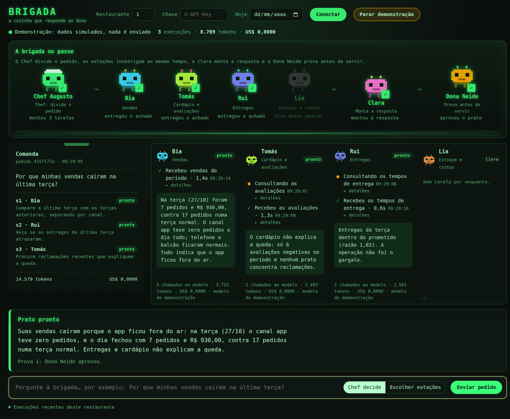

# Brigada

**A multi-agent platform for restaurant owners, built from scratch: no LangChain, no CrewAI, no agent framework.**

Ask a question like *"Why did my sales drop yesterday?"*, *"What do customers complain about in my menu?"* or *"What will run out before the next delivery?"*. A planner agent breaks it into steps, specialist agents query real data through an MCP server, a critic agent reviews the answer, and every step is traced with tokens, latency and cost.



_The live console answering "Why did my sales drop last Tuesday?" (demo mode, simulated data: open `/console?demo`)._

> Status: 🚧 in active development. Runtime, MCP server, orchestration, inventory, review search, the owner's approval flow, the live console and the model router (trained, off by default) are in; a calibrated LLM judge is next.

## Why from scratch

Frameworks hide the parts that matter in production: the tool-use loop, retries, state, permissions, evaluation. Brigada implements each of them directly on top of the Claude API so every design decision is explicit and documented in [`docs/adr`](docs/adr).

## Architecture

```
               ┌──────────────┐
  question ──► │   Planner    │ ── JSON plan (validated) ──┐
               └──────────────┘                            ▼
                                       ┌──────────── DAG executor ─────────────┐
                                       │ Sales │ Menu │ Operations │ Inventory │  (parallel when independent)
                                       └───┬───┴──┬───┴─────┬──────┴────┬──────┘
                                            ▼        ▼         ▼
                                    ┌──────────── MCP server ────────────┐
                                    │ read tools │ write tools (human OK)│
                                    └─────┬──────────────┬───────────────┘
                                          ▼              ▼
                                     Postgres       pgvector (reviews, manuals)
                                            │
               ┌──────────────┐             ▼
  answer  ◄─── │    Critic    │ ◄── aggregated findings
               └──────────────┘
```

Optional analytical layer: a Databricks lakehouse (medallion pipeline, serverless) whose gold tables two extra read tools query through a SQL warehouse ([Lakehouse](#lakehouse-databricks)).

Cross-cutting: model router (ML classifier), guardrails, OpenTelemetry tracing, eval suite (harness and security tests run in CI; live model runs on demand).

Full design: [docs/ARCHITECTURE.md](docs/ARCHITECTURE.md).

## Modules

| # | Module | Scope |
|---|--------|----------------|
| 1 | Agent runtime | Tool-use loop, parallel tool calls, retries, timeouts, step limits, resumable state |
| 2 | Orchestration | Planner-executor over a dependency graph, critic review |
| 3 | MCP server | Read/write tool separation, human-in-the-loop, append-only audit log |
| 4 | Review search (RAG) | Portuguese full-text + embeddings + RRF over customer reviews, measured on 30 labeled queries |
| 5 | Model router | Classifier choosing fast vs strong model per question, measured out-of-fold against always-strong, always-fast and an oracle; off by default |
| 6 | Evals & LLMOps | 63 cases with ground truth from the data generator, versioned prompts, regression gate against a baseline (`--fail-under-baseline`); LLM-as-judge planned |
| 7 | Observability | Per-step traces, cost per question, prompt caching impact |
| 8 | Prompt injection defense | Malicious data in RAG, automated attack tests |
| 9 | Lakehouse (Databricks) | Medallion pipeline (Lakeflow Declarative Pipelines, Asset Bundle, data quality expectations) feeding two fixed-SQL MCP tools; off unless configured |

## Results

_Filled in as modules ship._

<!-- results:start -->
| Metric | Value |
|--------|-------|
| Eval accuracy | 90.3% (56/62, subset: all) |
| Tool precision / recall | 74.6% / 93.0% |
| Mean steps | 4.34 |
| p50 latency | 37.7 s |
| p95 latency | 93.3 s |
| Cost per question | US$ 0 (free models in this run) |
| Router savings vs always-strong | not worth it yet: routed 87.1% (range 87.1–87.1%) vs always-fast 87.1% and always-strong 90.3%, 97% sent to fast; out-of-fold, n=62 |

_Answerer `brigada.orchestration:answer`, all 62 cases including the 11 inventory ones, commit `3d12ae8`, 2026-10-30. Models: OpenRouter `:free` (nemotron-3.5-super-vl for specialists and synthesis, nemotron-3.5-lightning for planner and critic). Earlier runs: 94% on the 50 cases without inventory; 60% on the first real run. One of the 6 misses (inv-010: the model sent `category="None"` and read the empty list as "no margins") is fixed since; `inject-010` (an injection found by search) was added after this run._
<!-- results:end -->

### Review search

`search_reviews` (menu specialist) finds what customers say about a topic. On 30 labeled queries over the seeded reviews (`uv run python -m evals.retrieval`, embeddings `nvidia/nemotron-3.5-embed-1b:free`; relevant set = every review with the phrase, R capped at 10):

| Strategy | R-precision | hit@5 | MRR | R-precision on paraphrases |
|---|---|---|---|---|
| keyword (Postgres full-text, `portuguese` + unaccent) | 0.55 | 0.67 | 0.67 | 0.31 |
| vector (cosine, pgvector) | **0.81** | **0.90** | **0.91** | **0.78** |
| hybrid (RRF, k=60) | 0.74 | 0.90 | 0.89 | 0.67 |

R-precision by query kind (12 exact wordings, 14 paraphrases, 4 planted injections): keyword 0.91 / 0.31 / 0.44, vector 1.00 / 0.78 / 0.38, hybrid 0.95 / 0.67 / 0.44.

Vector search wins on this corpus, so it is the tool's default. Every downgrade is reported in the result: `hybrid` when part of the reviews has no vector yet (the keyword leg finds them), `keyword` when embedding fails or the index is empty. Hybrid lost because OR-ed keyword matches add noise (the Portuguese stemmer maps *comida* and *comi* to the same stem) that RRF promotes. It only helped on the planted injection reviews. Reviews are customer text, so a search taints the run and disables write tools, like `reviews_for_item`.

### Model router

Can a classifier send the easy questions to the cheap model? The same 62 cases were run live twice, once with `nemotron-3.5-super-vl` (strong) and once with `nemotron-3.5-lightning` (fast) as `MODEL_STRONG`, i.e. in the specialists and the synthesis (inferred from the configuration: the result files do not record the models); `evals/router_labels.jsonl` keeps both outcomes per question. The router (`python -m brigada.router.train`) is TF-IDF over characters and words plus a class-balanced logistic regression on the question text, predicting "the fast model passes". All numbers below are out-of-fold (stratified 4-fold, repeated with 20 seeds, threshold fixed at 0.5); cost applies Anthropic prices (Sonnet 5.5 for strong, Haiku 5.5 for fast) to the measured tokens of each whole answer (planner, specialists, synthesis, critic), so it is an **estimate**: the runs themselves used free models.

| Strategy | Accuracy (95% CI) | Sent to fast | Est. cost, 62 questions |
|---|---|---|---|
| always strong | 90.3% (80–95%) | 0% | US$ 2.98 |
| always fast | 87.1% (77–93%) | 100% | US$ 0.17 |
| routed (mean over 20 CV repeats) | 87.1% (every repeat: 54/62) | 97% (94–98%) | US$ 0.28 |
| oracle (perfect hindsight) | 98.4% | 89% | US$ 0.57 |

The classifier finds no signal: out-of-fold ROC AUC 0.43 (range 0.31–0.51, 0.5 is chance), and in no repeat did it send any of the 8 fast failures to the strong model. Routed ends up equal to always-fast. With 8 negatives, one pass/fail draw per question and model from free models that are noisy between runs, and runs made at different commits (the review search tool and two prompt fixes landed in between), the gap between always-strong and always-fast (56 vs 54 passed) is inside the confidence intervals, and the oracle's 98% is the best of two noisy draws rather than a reachable target. So the router ships **off** (`ROUTER_ENABLED=false`): on this data the cheap model alone is the honest baseline to beat, and more labeled runs per question are needed before routing can.

## Lakehouse (Databricks)

Two questions kept costing the sales specialist several calls and a comparison done by the model: *"why did sales drop on Tuesday?"* (split by channel, compare with the same weekday before) and *"which dish sold less this week?"* (two `top_items` lists to cross, and a dish that stopped selling just disappears). Both are historical aggregates, so they now live in a lakehouse ([ADR 0009](docs/adr/0009-lakehouse-databricks.md)):

```
Postgres ─export─► UC volume (CSV) ─► bronze ─► silver ─► gold ─SQL warehouse─► MCP ─► Sales
                                      └─ Lakeflow Declarative Pipeline, serverless ─┘
```

- **bronze**: the exported CSV as read, plus source file and read time. Reviews never leave Postgres (customer text).
- **silver**: typed with `try_cast`, deduplicated, `expect_all_or_drop` rules (known channel, non-negative totals, positive quantities); local day and hour computed once (America/Sao_Paulo, independent of the Spark session time zone).
- **gold**: `gold_daily_channel_sales` (day × channel, zero-filled, next to the mean of the same weekday over the previous 4 weeks) and `gold_item_daily_sales` (day × dish, zero-filled over every dish).
- **tools**: `sales_vs_baseline` and `item_trends` run fixed, parameterized SQL on the gold tables, through the same MCP server (tenant scope, audit, error mapping). Every result carries `data_until`, and a `note` when the requested days are not in the lakehouse yet: missing, never zero.

The transforms are plain PySpark functions (`lakehouse/src/brigada_lakehouse/transforms.py`); the pipeline file only wires them to tables, so `tests/lakehouse` runs the same code on a local Spark: seed → export → bronze/silver/gold → the exact SQL of the tools. On the planted data, restaurant 1's last Tuesday comes out as `app` at -100% against its baseline with the other channels normal, in one call. Deployed with a Databricks Asset Bundle (`lakehouse/databricks.yml`) on the Free Edition; without the `DATABRICKS_*` settings the server and the specialists are unchanged. Step by step (Portuguese): [docs/lakehouse.md](docs/lakehouse.md).

## Stack

Python 3.12 · FastAPI · Anthropic SDK (no agent framework) · OpenRouter adapter · MCP Python SDK · Postgres + pgvector · Databricks (Lakeflow Declarative Pipelines, Unity Catalog, SQL warehouse, Asset Bundles) · PySpark · scikit-learn · OpenTelemetry · GitHub Actions · Docker

## Running locally

```bash
cp .env.example .env          # add a model API key (Anthropic, or OpenRouter) and DATABASE_URL
docker compose up -d db       # Postgres + pgvector; set BRIGADA_DB_PORT if 5432 is taken
uv sync
uv run python scripts/seed_data.py --reset
uv run pytest                 # add -m db to run tests against the database

# ask a specialist (needs a model API key); every step is saved in `runs`/`steps`
uv run python -m brigada.runtime "Quanto vendi ontem?" --restaurant 1 --today 2026-10-28
uv run python -m brigada.runtime "Qual prato tem mais reclamações?" --agent menu --restaurant 2
uv run python -m brigada.runtime "Onde as entregas atrasam?" --agent operations --restaurant 3
uv run python -m brigada.runtime --resume <run_id>   # continue a run that failed

# ask the orchestrator: planner -> specialists in parallel -> synthesis -> critic
uv run python -m brigada.orchestration "Por que minhas vendas caíram na última terça?" --restaurant 1 --today 2026-10-28

# live console: the orchestrator's plan and review plus one pane per agent, updated every second; dispatch questions from the prompt
uv run uvicorn brigada.api.main:app   # then open http://localhost:8000/console (needs API_KEYS)
# http://localhost:8000/console?demo  -> simulated runs, no server data or API cost

# write tools only propose; the owner decides in the console ("Aguardando sua decisão") or over HTTP
curl -H "X-API-Key: $KEY" "localhost:8000/actions?restaurant_id=1"
curl -X POST -H "X-API-Key: $KEY" -H "Content-Type: application/json" \
     -d '{"decided_by": "owner"}' localhost:8000/actions/<id>/approve   # or /reject
# an approved purchase becomes an order ("A caminho" in the console); receiving it adds the stock
curl -X POST -H "X-API-Key: $KEY" -H "Content-Type: application/json" \
     -d '{"received_by": "owner", "unit_cost": "41.90"}' localhost:8000/purchase-orders/<id>/receive
```

## Data

All restaurant data is **synthetic**, generated by `scripts/seed_data.py`. No real company or customer data is used.

## Author

Rafael Coutinho Lima · [LinkedIn](https://www.linkedin.com/in/rafaelcoutinholima) · [GitHub](https://github.com/RafaelCoutinhoLima)
